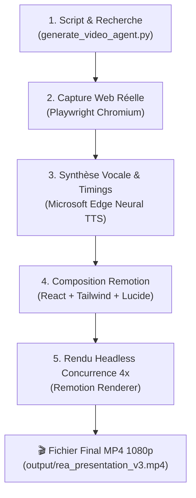

# 🎬 Agent Video Studio — Autonomous Video Generation Pipeline

> Pipeline d'automatisation complète de génération de vidéos tech documentaires (Video Essays) en 1080p Full HD, pilotée par le code (Remotion, Playwright, Edge-TTS).

---

## 🌟 Présentation

Ce dépôt contient la pipeline logicielle autonome permettant à un agent IA de produire une vidéo de vulgarisation ou de démonstration technique complète de bout en bout, sans aucun montage manuel :

1. **Capture web automatisée (Playwright) :** Navigation autonome sur les dépôts GitHub et sites officiels, extraction de métriques réelles (stars, forks, commits) et captures Retina 2x.
2. **Double flux vocal & textuel (Phonétisation) :** Synthèse vocale neuronale HD française (`edge-tts`) avec phonétisation des termes techniques (`GitHub` prononcé correctement via phonétique `Guite Heube`) tout en conservant une typographie irréprochable dans les sous-titres.
3. **Synchronisation milliseconde (Karaoké) :** Alignement temporel des mots pour un surlignage dynamique en temps réel.
4. **Motion Design programmatique (Remotion 4 + TailwindCSS 4) :** Rendu vectoriel haute fidélité avec physique d'amortissement (`Spring physics`), fenêtres macOS réalistes, terminaux CLI interactifs, et comparateurs d'outils multi-onglets.
5. **Sound Design adaptatif :** Bruitages procéduraux synchronisés (*whoosh*, *pop*, *click*) et mixage audio avec *ducking* automatique de la musique ambiante sous la voix.

---

## 🏗️ Architecture de la Pipeline



---

## 📁 Structure du Projet

```
agent-video-pipeline/
├── README.md
├── requirements.txt              # Dépendances Python (playwright, edge-tts)
├── setup.sh                      # Script d'installation automatique en 1 clic
├── generate_video_agent.py       # Orchestrateur central de la pipeline
└── agent-video-studio/           # Studio Remotion (React / TypeScript)
    ├── remotion.config.ts        # Configuration d'encodage (1080p, 30fps)
    ├── package.json
    ├── public/
    │   ├── assets/               # Captures réelles & fichier audio généré
    │   └── sfx/                  # Effets sonores procéduraux & musique ambiante
    └── src/
        ├── VideoEssay.tsx        # Composition maîtresse et mixage audio
        ├── video_data.json       # Fichier d'orchestration synchronisé
        ├── components/
        │   ├── Background.tsx    # Fond cybernétique avec halos réactifs
        │   ├── MacWindow.tsx     # Mockup de fenêtre macOS
        │   └── Subtitles.tsx     # Moteur de sous-titres karaoké
        └── scenes/
            ├── HookScene.tsx             # Accroche percutante
            ├── BrowserScene.tsx          # Dépôt GitHub & métriques virales
            ├── NativeHopperScene.tsx     # Désassemblage Hopper & Ghidra
            ├── MultiplatformScene.tsx    # Runtimes Electron, Android, Frida
            ├── TerminalScene.tsx         # Console interactif & protocole MCP
            ├── CaseStudyScene.tsx        # Étude de cas Adobe vs Alternatives Libres
            ├── EthicsScene.tsx           # Droit européen & pérennité
            └── OutroScene.tsx            # Conclusion & appel à l'action
```

---

## ⚡ Installation Rapide

### Prérequis
- **Node.js** 18+ & npm
- **Python** 3.10+
- **ffmpeg** (recommandé pour les codecs vidéo natifs)

### 1. Installation automatique
Exécutez le script d'initialisation :
```bash
chmod +x setup.sh
./setup.sh
```

Ce script configure :
- L'environnement virtuel Python (`.venv`)
- Les packages Python nécessaires (`playwright`, `edge-tts`)
- Le navigateur Chromium headless pour les captures web
- Les dépendances npm de Remotion

---

## 🚀 Utilisation

### Générer une vidéo complète
Activez l'environnement virtuel et lancez le script maître :

```bash
source .venv/bin/activate
python3 generate_video_agent.py --url "https://github.com/morluto/rea" --output "output/ma_video.mp4"
```

### Visualiser le studio en direct (Mode Preview Remotion)
Pour ajuster les scènes, tester les animations et inspecter les frames dans le navigateur :

```bash
cd agent-video-studio
npm start
```
Le serveur local Remotion s'ouvrira sur `http://localhost:3000`.

---

## 🎬 Résultat Produit

- **Format :** MP4 (H.264 / AAC)
- **Résolution :** 1920 × 1080 (Full HD 16:9)
- **Cadence :** 30 images par seconde
- **Audio :** Voix neuronale française haute définition + musique cybernétique duckée + SFX synchronisés.

---

## 📄 Licence

MIT © [Najmabdi7](https://github.com/Najmabdi7)
